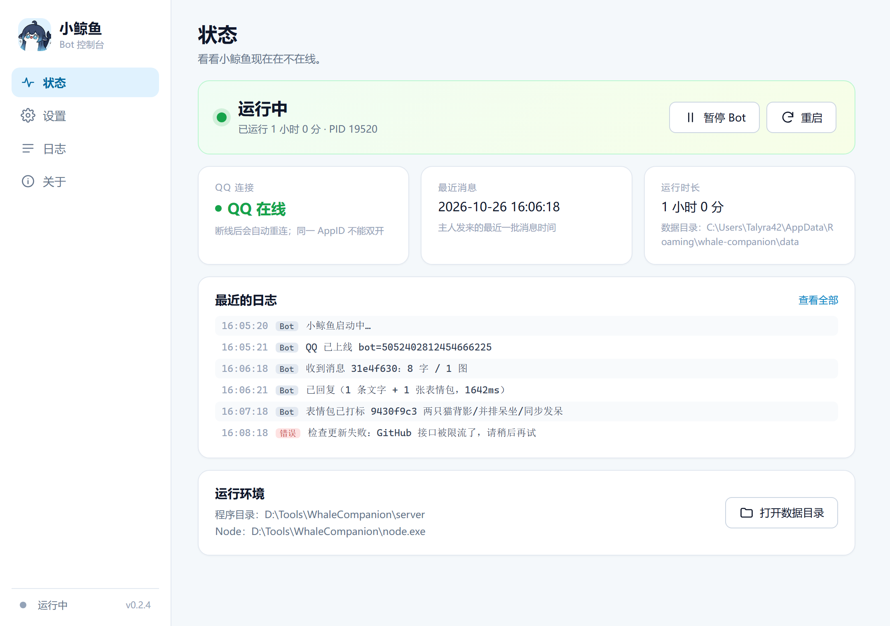
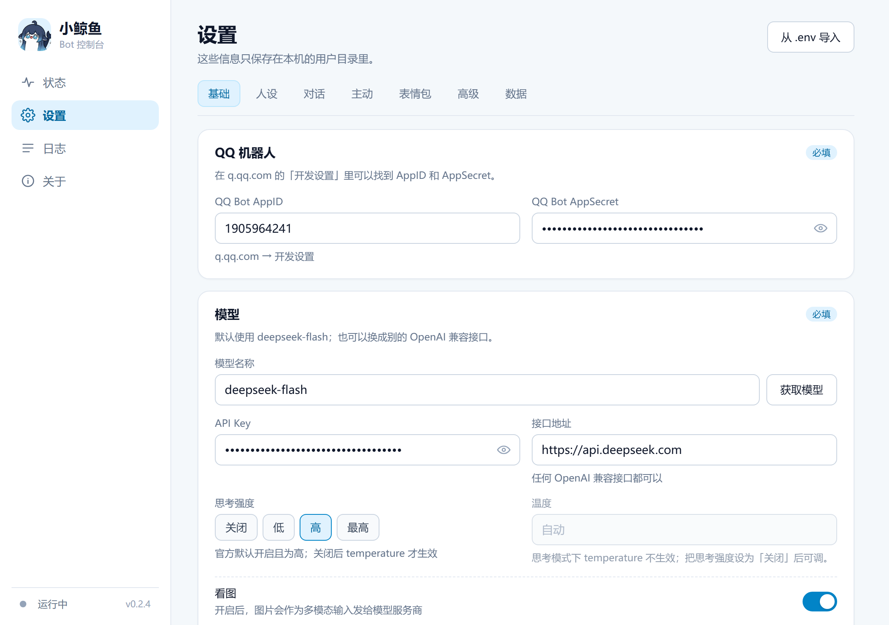
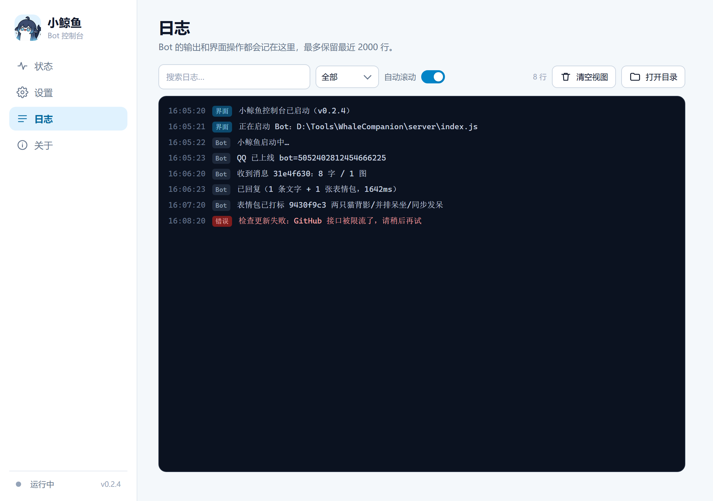
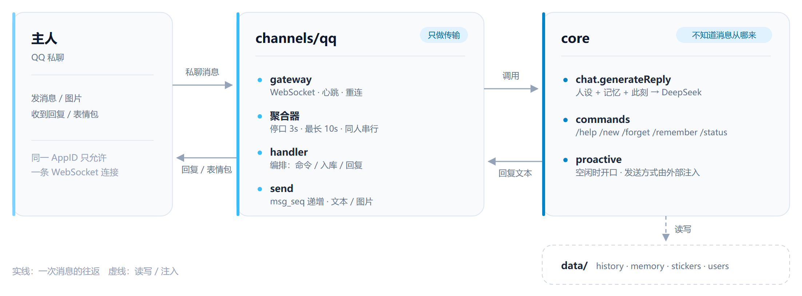

<p align="center">
  
</p>

<h1 align="center">小鲸鱼 · 独立陪伴 AI</h1>

<p align="center">
  一只住进 <b>QQ 私聊</b> 的陪伴机器人 —— 有人设、有记忆、会发表情包，也会自己找你说话。<br />
  附带一个 Windows 桌面控制台：填配置、看状态、翻日志，双击就能用。
</p>

<p align="center">
  <a href="https://github.com/Talyra42/whale-companion/releases"></a>
  
  
  
  
</p>

<p align="center">
  <a href="#截图">截图</a> ·
  <a href="#功能">功能</a> ·
  <a href="#技术栈">技术栈</a> ·
  <a href="#快速开始">快速开始</a> ·
  <a href="#它怎么工作">架构</a> ·
  <a href="#常见问题">常见问题</a>
</p>

---

## 截图

<p align="center">
  
  <br />
  <sub>状态页：运行状态、QQ 连接、最近消息与实时日志</sub>
</p>

<p align="center">
  
  <br />
  <sub>设置页：QQ / DeepSeek 配置、关窗行为、开机自启，支持从 .env 导入</sub>
</p>

<p align="center">
  
  <br />
  <sub>日志页：实时滚动、按来源筛选、搜索、打开日志目录</sub>
</p>

<sub>截图中的路径与密钥均为演示数据。</sub>

## 功能

**像人一样聊天**

- 一条消息说完，只有超过 500 字才在自然停顿处切开，不刷屏
- 你连发多条 / 多图，会合并成一轮再回（停口 3 秒，从第一条起最多等 10 秒）
- 一天一个心情，还会按时段调语气：清早迷糊一点，深夜小声一点
- 看得懂图：发来的图片会作为多模态输入（单张上限 8MB）

**记得住人**

- 最近 40 条原文 + 一段长期摘要 + 你亲口让她记住的事，每轮都注入人设之外
- 聊到 150 条自动把老对话压成摘要，原文只留最近的，不会越长越糊
- `/remember 我不吃香菜` 可以直接写进长期记忆

**表情包**

- 你发的图立即入库，标签在后台补（不挡这一轮回复）
- 想发就在回复末尾写 `[表情包:关键词]`，按语义（字符二元组 + 余弦）挑最贴切的一张
- 模型主动要图时**只发命中的**，宁可不发也不乱发；你明确说「发个表情包」才允许随机兜底
- 同一个人 8 分钟冷却，自发跟图概率 5%

**主动与命令**

- 空闲且不在免打扰时段时，她会自己开口说一句（受平台主动消息额度限制）
- `/help` `/new` `/forget` `/memory` `/remember` `/status`

**桌面控制台**

- 状态页、设置页、日志页、关于页，配色和文案都是照着「养成」的感觉做的
- 托盘菜单：显示主界面、暂停 / 启动、重启、打开日志 / 数据目录、退出
- 单实例锁，不会两个进程抢同一条 QQ 连接
- 关窗默认最小化到托盘；也可设为直接退出
- GUI 崩溃时 Bot 会自己退出（父进程看门狗），不留孤儿进程占着连接
- 开机自启（写 `HKCU\...\Run`）

## 技术栈

| 层 | 选型 | 说明 |
| --- | --- | --- |
| Bot 运行时 | **Node.js ≥ 22 · TypeScript** | `tsx` 直接跑 TS，没有 Web 框架 |
| 模型 | **DeepSeek `deepseek-flash`** | OpenAI 兼容接口，`DEEPSEEK_BASE_URL` / `DEEPSEEK_MODEL` 可换 |
| QQ 通道 | **QQ 官方机器人 API** | 原生 `fetch` + `WebSocket`，自带心跳、断线重连、token 缓存 |
| 桌面控制台 | **Neutralino 6 · React 19 · Vite** | 用系统 WebView2，仅 Windows；不打包 Chromium |
| 打包 | `neu build` + 内置 `node.exe` | 便携 zip，用户不用装 Node |
| 测试 | `node:test` + `tsx` | 纯函数、聚合器、配置解析都有单测 |
| CI | **GitHub Actions** | Windows runner 构建；推 `v*` tag 自动创建 Release |

几个刻意的取舍：

- **不用 Electron**：桌面端只管一个本地进程和四页界面，Neutralino 只有几 MB，直接用系统 WebView2。
- **不用 Hono / Nest**：只有一个 QQ 长连接和几个 JSON 文件，加一层框架不如直接读代码。
- **core 不知道 QQ 的存在**：想加新通道（命令行、其他 IM）只写 `channels/xxx/`，主动消息的发送方式由组合根注入。

## 快速开始

### 方式一：桌面版（推荐）

1. 从 [Releases](https://github.com/Talyra42/whale-companion/releases) 下载 `whale-companion-*-win-x64.zip`，解压到任意目录
2. 双击 `WhaleCompanion.exe`；首次启动会自动打开设置页
3. 填 **QQ Bot 的 AppID / AppSecret** 和 **DeepSeek API Key**，保存后 Bot 自动启动

便携包自带 `node.exe`，不需要另外装环境。已有 `.env` 的话，放到 `WhaleCompanion\server\.env`，
再点设置页右上角的「从 .env 导入」即可。

数据都在 `%APPDATA%\whale-companion`：

```
config.json     桌面端设置
bot.json        启动 Bot 用的临时配置（含密钥）
data/           聊天记录、记忆、表情包
logs/           每日日志
app.lock        单实例锁
```

### 方式二：命令行

```bash
pnpm install
cp apps/server/.env.example apps/server/.env   # 填 DEEPSEEK_API_KEY / QQBOT_APPID / QQBOT_SECRET
pnpm dev
```

Windows 下也可以直接 `Copy-Item apps/server/.env.example apps/server/.env`。

### QQ 端要做的两件事

1. 在 [q.qq.com](https://q.qq.com) 的「开发设置 → 事件订阅」里选择 **WebSocket**
2. 把你的 QQ 号加进「内部体验号码」，然后用手机私聊它

## 它怎么工作

<p align="center">
  
</p>

一条消息的旅程：

1. **收**：WebSocket 事件 → 清洗 `<faceType=…>` / `<@…>` 平台标记 → 串行下载图片
2. **攒**：聚合器按「停口 3 秒」合并连发；一直发也最多等 10 秒；同一个人串行处理
3. **判断**：斜杠命令直接回；图片先入库、标签丢后台；「发个表情包」走挑图
4. **想**：人设 + 长期记忆 + 此刻 + 心情 + 图库可用性 → 调模型
5. **发**：剥掉 `[表情包:关键词]` → 整条发出（超长才切）→ 想发就紧跟一张图

## 架构

```
apps/
  server/                Bot 本体
    persona.md           人设正文（每轮现读，改完下一条生效）
    src/config.ts        所有环境变量在此收口
    src/core/            对话 / 提示词 / 切分 / 记忆压缩 / 心情 / 表情包 / 主动消息
    src/store/           history / memory / stickers / users
    src/channels/qq/     token / send / media / text / aggregator / handler / gateway
    src/index.ts         组合根：启动 QQ + 主动消息 + 补齐标签
  desktop/               Windows 控制台（Neutralino + React）
    src/lib/             配置、路径、锁、日志、进程命令（纯函数 + 单测）
    src/hooks/           托盘、子进程、单实例、状态与日志编排
    src/components/      状态 / 设置 / 日志 / 关于
docs/
  screenshots/          README 截图
  assets/               图标 · 架构图 · 社交预览图
```

分层铁律（改代码前先看这条）：

1. `core/` 不知道消息从哪来，也不直接发 QQ；主动消息只接受注入的 `send` 回调
2. `channels/` 只做传输：收事件、发消息、下附件、清洗平台标记
3. `store/` 只做持久化，不做业务判断
4. 桌面端不 import 服务端源码，只通过「启动子进程 + `--config` + stdout 状态行」控制 Bot

## 数据与隐私

- `apps/server/data/`、`.env` 全部 gitignore；聊天记录、图片、记忆都只在本机
- 桌面版把密钥明文存在 `%APPDATA%\whale-companion\config.json`（和原来的 `.env` 一致）
- 图片上传走 QQ 官方接口，不经过第三方图床
- 服务端没有对外 HTTP 端口；除了 QQ 官方 API 和模型接口，不主动连任何地方

## 常用命令

```bash
pnpm dev              # 只启动机器人（tsx watch）
pnpm build            # 构建 Bot（desktop:dev 需要）
pnpm desktop:dev      # 启动桌面控制台（开发态）
pnpm desktop:pack     # 打 Windows 便携 zip
pnpm typecheck        # 两个包都查
pnpm test             # 两个包的单测
pnpm release patch    # 发版：bump + tag + push（触发 CI）
```

打包产物：`apps/desktop/dist/whale-companion-<version>-win-x64.zip`。

## 常见问题

| 现象 | 先看这里 |
| --- | --- |
| 手机私聊没反应 | q.qq.com 的事件订阅是不是 **WebSocket**；QQ 号在不在「内部体验号码」；是不是同时开了两个 Bot |
| 日志里出现 `4009` | 同一个 AppID 只允许一条 WebSocket 连接，把另一个实例 / 客户端关掉 |
| 她从不主动说话 | 主动消息受平台额度限制，失败只记日志；再确认 `PROACTIVE_ENABLED` 和免打扰时段（默认 23:00–9:00） |
| 表情包不发或很离谱 | 看图库标签质量、`MIN_SCORE` 阈值、8 分钟冷却；模型主动要图时只发语义命中的 |
| 记忆像没生效 | `data/history.json` 与 `memory/<userId>.json` 是否在写；压缩阈值 `HISTORY_SUMMARIZE_AT` |
| exe 被 SmartScreen 拦 | 未签名，点「更多信息 → 仍要运行」；介意的话自己 `pnpm desktop:pack` 重新构建 |
| 桌面端 Bot 起不来 | `%APPDATA%\whale-companion\logs`、`bot.json`；开发态先 `pnpm build` |

更细的排障索引在 [`AGENTS.md`](AGENTS.md) 第 16 节。

## 已知限制

- 只有 QQ 私聊，没有群聊，也没有 Web 调试台
- 主动消息不保证送达（平台限制）
- 桌面版只有便携 zip，没有安装包；exe 未签名
- 第二个实例只提示并退出，不会把已有窗口调到前台
- 挑图依赖标签质量，同义不同词（「高兴」vs「开心」）可能漏
- `history.json` 每次全量重写，没有原子写；单用户小规模够用，并发写会丢
- 存储读写、真实 QQ 链路、Neutralino 托盘目前没有自动化测试

## 文档与参与

| 文档 | 内容 |
| --- | --- |
| [`AGENTS.md`](AGENTS.md) | 架构、分层、QQ / Windows 踩坑、排障索引 |
| [`CHANGELOG.md`](CHANGELOG.md) | 版本记录 |
| [`apps/desktop/README.md`](apps/desktop/README.md) | 桌面端开发与打包 |
| [`apps/server/README.md`](apps/server/README.md) | 服务端入口 |
| [`docs/README.md`](docs/README.md) | 截图、架构图、社交预览图的来源与更新方法 |

这是一个偏个人的项目，但 issue 和 PR 都欢迎。动代码之前建议先读 `AGENTS.md`：
里面的「QQ 平台踩过的坑」和「Windows 大坑」能省掉大半天。

## License

[AGPL-3.0-only](LICENSE) · Copyright (C) 2026 Talyra42

简单说：你可以改、可以自己跑，但如果拿它（或改过的版本）对外提供网络服务，必须把源码同样以 AGPL 开放。想闭源商用是不行的。
